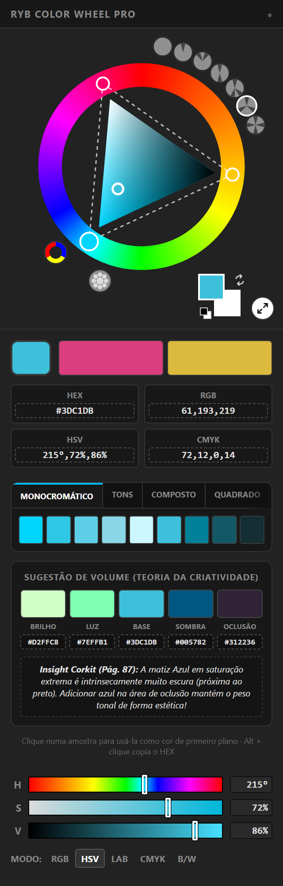

# Círculo Cromático RYB

Círculo cromático com harmonias, paletas e sugestão de luz e sombra para quem pinta e ilustra.
Funciona como **página web** (um único arquivo HTML) e como **painel para o Photoshop**, ligado às cores de primeiro plano e plano de fundo.

<p align="center">
  
</p>

## Recursos

- **Círculo RYB ou RGB:** alterna entre o círculo dos pintores (vermelho, amarelo e azul) e o círculo da luz (RGB).
- **Triângulo de saturação e valor**, com opção de **travar a luminosidade** enquanto troca a saturação.
- **7 esquemas de harmonia** marcados no anel: livre, monocromático, análogas, complementar, meio-complementar, tríade e tétrade.
- **Paletas de 9 cores** em 8 variações: monocromático, tons, composto, quadrado, tríade, meio-complementar, complementar e análogas.
- **Sugestão de volume:** brilho, luz, base, sombra e oclusão, deslocando a matiz para tons quentes na luz e frios na sombra, com dicas de teoria da cor.
- **Valores editáveis** em HEX, RGB, HSV e CMYK, e **sliders** em RGB, HSV, LAB, CMYK e preto e branco.
- **Cor principal e secundária** no estilo do Photoshop, com troca e volta ao preto e branco.
- Na versão web, clique em qualquer cor para copiar o HEX.

## Plugin para o Photoshop

O painel funciona no **Photoshop 2024 (versão 25) ou mais novo**, no Windows e no Mac.

- Arrastar no círculo muda a **cor de primeiro plano** do Photoshop na hora; a cor secundária vira a de **plano de fundo**.
- Conta-gotas, seletor de cores e os atalhos `X` e `D` do Photoshop atualizam o círculo automaticamente.
- Clicar numa amostra das paletas a define como cor de primeiro plano; **Alt + clique** copia o HEX.
- **Modo compacto** para deixar só o círculo e as harmonias no painel.

### Instalação

1. Baixe o instalador [**Circulo-Cromatico.ccx**](https://github.com/kennethcezar1998-glitch/circulo-cromatico/raw/master/dist/Circulo-Cromatico.ccx).
2. Com o Photoshop fechado, dê dois cliques no arquivo e confirme a instalação no aplicativo Creative Cloud.
3. Abra o Photoshop e vá em **Plug-ins › Círculo Cromático RYB › Círculo Cromático**.

Se o duplo clique não funcionar, siga o passo a passo completo em [**COMO INSTALAR.md**](COMO%20INSTALAR.md), que traz a instalação por linha de comando, como desinstalar e soluções para erros comuns.

## Versão web

Baixe [`circulo cromatico ativo .html`](circulo%20cromatico%20ativo%20.html) e abra no navegador. Não precisa de instalação nem de internet.

## Estrutura do repositório

| Caminho | Conteúdo |
|---|---|
| `circulo cromatico ativo .html` | Versão web completa, num único arquivo |
| `photoshop-plugin/` | Código do plugin UXP: `manifest.json`, `index.html`, `style.css`, `main.js` e ícones |
| `dist/` | Instalador `.ccx` pronto e guia de instalação em HTML |
| `empacotar-plugin.ps1` | Gera o `.ccx` a partir de `photoshop-plugin/` |
| `COMO INSTALAR.md` | Passo a passo de instalação do plugin |
| `docs/` | Imagens do README |

## Desenvolvimento

**Testar a interface no navegador.** O plugin também roda fora do Photoshop, sem a ligação com as cores:

```powershell
python -m http.server 8765 --directory photoshop-plugin
```

Depois abra `http://localhost:8765`.

**Testar dentro do Photoshop.**

1. Em **Editar › Preferências › Plug-ins**, ative o **Modo de Desenvolvedor** e reinicie o Photoshop.
2. Instale o **UXP Developer Tool** pelo aplicativo Creative Cloud.
3. Clique em **Add Plugin**, escolha `photoshop-plugin/manifest.json` e depois em **Load**. Use **Watch** para recarregar a cada alteração.

**Gerar um novo instalador.** Aumente `version` em `photoshop-plugin/manifest.json` e rode:

```powershell
powershell -ExecutionPolicy Bypass -File .\empacotar-plugin.ps1
```

O arquivo sai em `dist/Circulo-Cromatico.ccx`.

### Observações sobre o UXP

O Photoshop não roda os painéis num navegador completo, então o plugin evita recursos que o UXP não suporta: CSS grid, `conic-gradient`, pseudo-elementos, `transform`, `contenteditable` e `clip()`/`setLineDash()` no canvas. Por isso os ícones são SVG, os sliders são desenhados à mão e o triângulo é pintado sem recorte.
